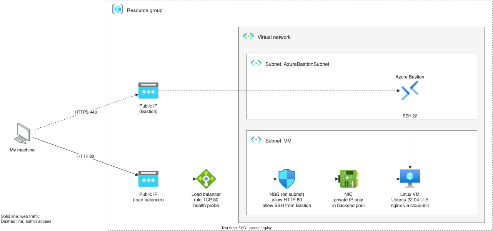

# 02 - Load balancer and private web VM

## Description

A Linux VM running a web server (nginx) without a public IP of its own. Web traffic from the internet goes through an Azure Load Balancer, and the VM installs nginx itself on first boot with cloud-init.

## Purpose

This project builds on [01-vnet-linux-vm](../01-vnet-linux-vm/). The goal is to learn:

- Azure Load Balancer: frontend IP, backend pool, health probe and load balancing rule
- Bootstrapping a VM with cloud-init (`custom_data`) so it configures itself on first boot
- Running a VM without a public IP, so it can only be reached through the load balancer
- NSG rules for web traffic
- Azure Bastion for admin (SSH) access to a VM that has no public IP

Security angle: compared to project 01, the VM is no longer directly exposed to the internet. That is a smaller attack surface.

## Architecture

The solution consists of:

| Resource | Purpose |
| --- | --- |
| Resource group | Container for all resources in the project |
| Virtual network + subnet | Private network the VM lives in |
| Network security group | Allows HTTP to the VM, restricts everything else |
| Load balancer + public IP | Public entry point that forwards web traffic to the VM |
| Network interface | Connects the VM to the subnet and the load balancer's backend pool (private IP only) |
| Linux virtual machine | Ubuntu VM that installs nginx with cloud-init |
| Azure Bastion | Admin (SSH) access to the private VM through the Azure portal, without exposing port 22 to the internet |



Web traffic (solid line) comes in on the load balancer's public IP, which forwards HTTP to the VM's private IP. Admin access (dashed line) goes through Azure Bastion: I connect over HTTPS in the Azure portal, and Bastion opens SSH to the VM inside the virtual network.

The diagram is made in draw.io. Open `diagrams/architecture.drawio.svg` in draw.io to edit it.

## Deployment

**Prerequisites:** Azure CLI, Terraform, and an SSH key pair.

```bash
az login
cd terraform
terraform init
terraform plan
terraform apply
```

Test the web server:

```bash
curl http://<load-balancer-public-ip>
```

Connect to the VM: Azure portal → the VM → **Connect** → **Bastion**.

Tear everything down when done, so nothing keeps costing money:

```bash
terraform destroy
```

## Lessons learned

_What did I learn? Which challenges did I run into, and what would I do differently?_
