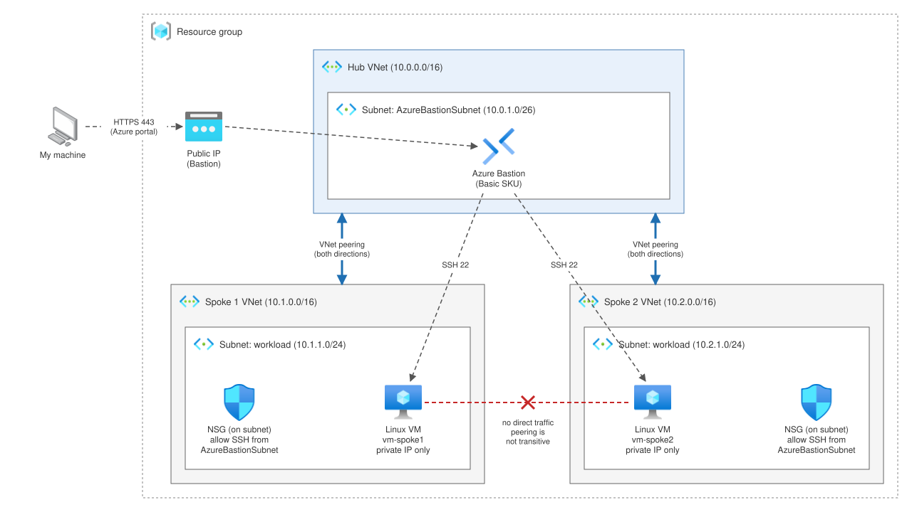

# 03 - Hub and spoke network

## Description

A simple hub-and-spoke network in Azure: one hub virtual network with shared services (Azure Bastion), and two spoke virtual networks that each run a small Linux VM without a public IP. Each spoke is connected to the hub with VNet peering. The two spokes are not connected to each other.

## Purpose

This project builds on [02-load-balancer-web-vm](../02-load-balancer-web-vm/). The goal is to learn:

- The hub-and-spoke topology, and why it is the standard network design in Azure
- VNet peering: how to connect two virtual networks, and why a peering must be created from both sides
- That VNet peering is **not transitive**: spoke 1 and spoke 2 can both reach the hub, but not each other
- Planning address space across several VNets, so their ranges do not overlap (peering requires that)
- Sharing one service (Azure Bastion) in the hub instead of deploying one per VNet

Security angle: the spokes are isolated from each other by default, and there is a single admin entry point (Bastion in the hub) for every VM. The hub is also where central security controls, such as a firewall, would live later.

## Architecture

The solution consists of:

| Resource | Purpose |
| --- | --- |
| Resource group | Container for all resources in the project |
| Hub virtual network (`10.0.0.0/16`) | Central network for shared services |
| AzureBastionSubnet (`10.0.1.0/26`) | Dedicated subnet that Azure Bastion requires (name and minimum size `/26` are fixed) |
| Azure Bastion (Basic SKU) + public IP | Admin (SSH) access to the VMs in both spokes through the Azure portal |
| Spoke 1 virtual network (`10.1.0.0/16`) + workload subnet (`10.1.1.0/24`) | Network for workload 1 |
| Spoke 2 virtual network (`10.2.0.0/16`) + workload subnet (`10.2.1.0/24`) | Network for workload 2 |
| VNet peerings (hub ↔ spoke 1, hub ↔ spoke 2) | Connect each spoke to the hub. One peering per direction, so four in total |
| Network security group (one per spoke subnet) | Only allows SSH from the AzureBastionSubnet |
| Network interface + Linux VM (one per spoke) | Small Ubuntu VM with a private IP only |



The thick blue arrows are the VNet peerings between the hub and each spoke. Admin access (dashed lines) goes through Azure Bastion in the hub: I connect over HTTPS in the Azure portal, and Bastion opens SSH to the VM in a spoke across the peering. The red dashed line shows traffic that does **not** work: VM-to-VM traffic between the spokes, because peering is not transitive.

The diagram is made in draw.io. Open `diagrams/architecture.drawio.svg` in draw.io to edit it.

### Address plan

| Network | Address space | Subnet |
| --- | --- | --- |
| Hub | `10.0.0.0/16` | AzureBastionSubnet `10.0.1.0/26` |
| Spoke 1 | `10.1.0.0/16` | workload `10.1.1.0/24` |
| Spoke 2 | `10.2.0.0/16` | workload `10.2.1.0/24` |

### Notes

- Bastion needs the **Basic SKU or higher** to reach VMs in peered VNets. The Developer SKU does not support peering.
- Bastion costs money per hour even when it is not used, so destroy the environment when done.

## Deployment

**Prerequisites:** Azure CLI, Terraform, and an SSH key pair.

```bash
az login
cd terraform
terraform init
terraform plan
terraform apply
```

Connect to a VM: Azure portal → the VM → **Connect** → **Bastion**.

### Verify the design

1. Connect to `vm-spoke1` with Bastion. This should work, since Bastion in the hub reaches the spoke over the peering.
2. From `vm-spoke1`, try to reach the private IP of `vm-spoke2` (for example `ping` or `ssh`). This should **fail**, because peering is not transitive.
3. Look at the effective routes on a VM's network interface (Azure portal → NIC → **Effective routes**, or `az network nic show-effective-route-table`). There should be a route to the hub's address space with next hop type `VNetPeering`, and no route to the other spoke.

Tear everything down when done, so nothing keeps costing money:

```bash
terraform destroy
```

## Ideas for later

- Let the spokes talk to each other through the hub: put a firewall or network virtual appliance (NVA) in the hub, and add route tables (user-defined routes) in the spokes that send traffic through it.
- Use `cidrsubnet()` to calculate the subnet ranges from the VNet address space instead of hardcoding them.

## Lessons learned

_What did I learn? Which challenges did I run into, and what would I do differently?_
